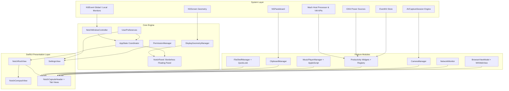
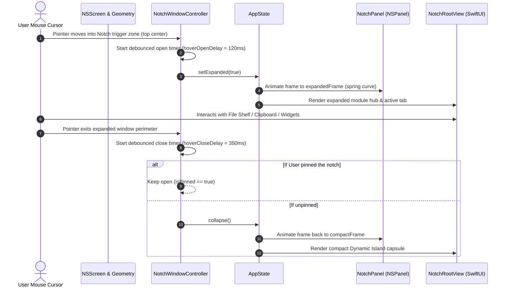

# ApexNotch: Architecture & Technical Design

This document details the architectural decisions, design patterns, threading model, and subsystem relationships that power **ApexNotch**.

---

## 🏛️ High-Level System Architecture

---

## 🔄 Interaction & Hover Lifecycle Flow

---

## 🧵 Threading & Concurrency Model

ApexNotch adheres to **Swift 6 strict concurrency (`ApproachableConcurrency`)**:

1. **MainActor Isolation:**
   - All UI elements, SwiftUI Views, `AppState`, `UserPreferences`, `NotchPanel`, `NotchWindowController`, and `SettingsWindowController` are `@MainActor`-isolated.
   - All state mutations are guaranteed to execute on the main thread, eliminating UI stutter and race conditions.

2. **Background Detached Tasks:**
   - **AppleScript Media Querying:** Queries to Apple Music and Spotify run in `Task.detached(priority: .userInitiated)` to avoid blocking the main UI thread during Apple Event resolution.
   - **Network Byte Counters:** BSD `getifaddrs` sampling occurs asynchronously and updates `@Published` properties on `@MainActor`.
   - **Camera Stream Management:** `AVCaptureSession` configuration and start/stop routines run on a dedicated serial background queue (`sessionQueue`), while the preview layer is rendered seamlessly via CoreAnimation.

3. **Lifecycle-Aware Resource Pausing:**
   - When the notch is collapsed:
     - `CameraManager` halts video capture.
     - `AudioVisualizerView` halts equalizer bar timers.
     - `NetworkMonitor` pauses polling intervals.
     - `SystemStatsService` pauses CPU load calculations.
   - This ensures **idle CPU consumption remains < 0.2%** on Apple Silicon Macs.

---

## 💾 Local Storage Schema

All persistent state is saved in `~/Library/Application Support/ApexNotch/`:

- `pinned_shelf.json`: Contains security-scoped bookmark records for files pinned to the shelf.
- `clipboard_history.json`: Encoded `[ClipboardItem]` records with timestamps, types, and pinned flags.
- `quick_notes.txt`: Auto-saved scratchpad text.
- `bookmarks.json`: User-configured quick bookmarks list.
- `widgets_config.json`: Enabled/disabled widget registry configuration.
- `UserDefaults`: Notch dimensions, animation speeds, player preference, search engine selection.
