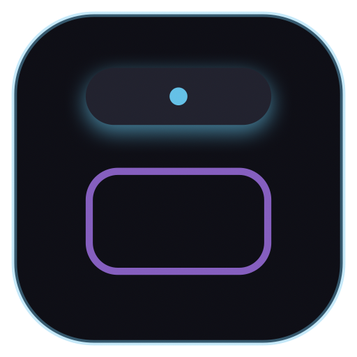

# ApexNotch ⚡️

<p align="center">
  
</p>

<h3 align="center">The Native Dynamic Island Super Utility for macOS</h3>

<p align="center">
  <strong>Transform your MacBook notch and top menu area into a sleek, interactive productivity command center.</strong>
</p>

<p align="center">
  <a href="https://github.com/Anvithgopa/ApexNotch/releases/latest"></a>
  <a href="https://github.com/Anvithgopa/ApexNotch/blob/main/LICENSE"></a>
  <a href="https://developer.apple.com/macos/"></a>
  <a href="https://swift.org"></a>
  <a href="https://payments.cashfree.com/forms/supportMe"></a>
</p>

<p align="center">
  <a href="https://github.com/Anvithgopa/ApexNotch/releases/latest">
    
  </a>
  &nbsp;&nbsp;
  <a href="https://payments.cashfree.com/forms/supportMe">
    
  </a>
</p>

---

## ☕ Support the Project

ApexNotch is **100% free, privacy-first, and open source**. It is maintained with love and care for the Mac community.

If ApexNotch saves you time, supercharges your workflow, or brings joy with Notch Pets, please consider supporting ongoing development:

<p align="center">
  <a href="https://payments.cashfree.com/forms/supportMe">
    
  </a>
  <br>
  <strong>Direct Link:</strong> <a href="https://payments.cashfree.com/forms/supportMe">https://payments.cashfree.com/forms/supportMe</a>
</p>

Your generous support helps fund new features, hardware testing across different Mac models, and continuous improvements! 💛

---

## 🌟 Highlights & Features

ApexNotch breathes life into the top of your display. Whether your MacBook has a hardware camera notch or you are on an external monitor / MacBook Air, ApexNotch hugs the display geometry seamlessly, expanding into an elegant multi-module dashboard upon hover, click, or keyboard shortcut.

### 🐾 1. Notch Mascot Pets (CPU & Performance Adaptive)
Bring a playful companion to your notch! Choose between cute companions:
- 🐱 **Cat**, 🐶 **Dog**, 🦊 **Fox**, 🦦 **Otter**, 🐰 **Rabbit**, 🐹 **Hamster**
- **Dynamic Speed:** Mascot animation runs faster or slower in real time according to your laptop's CPU speed and system performance.
- **Interactive Speech Bubbles:** Mascot reacts with witty remarks, status prompts, and system insights.

### 🎵 2. Dynamic Music Visualizer & Album Artwork
- **4 Visualizer Styles:** Equalizer Bars, Smooth Waveforms, Floating Particles, and Minimal Dots.
- **Album Artwork Display:** High-resolution album cover thumbnail right beside your music controls.
- **Player Integrations:** Seamless zero-setup controls for **Apple Music** and **Spotify** (Play, Pause, Skip, Scrub).
- Pauses rendering automatically when collapsed to maintain zero battery impact.

### 🗄️ 3. Quick File Shelf & Drag-and-Drop Staging Zone
- **Drag-In Staging:** Drag files or folders to the notch — the hub stays open and catches drops smoothly without hiding!
- **Visual File Cards:** Rich icon previews, file sizes, and creation dates.
- **Drag-Out Support:** Drag files directly into Slack, Mail, Desktop, GitHub, or any browser window.
- **Native Quick Look & AirDrop:** Press Spacebar or click the eye icon for instant full-size previews; share in one click via AirDrop.

### 📋 4. Smart Clipboard Manager with Auto Secret Redaction
- **Instant History:** Keeps your recently copied text snippets, links, and code snippets ready to reuse.
- **Security Redaction Engine:** Automatically recognizes and masks sensitive credentials:
  - GitHub Personal Access Tokens (`ghp_`)
  - OpenAI API Keys (`sk-`)
  - AWS Access Keys (`AKIA`)
  - Private RSA Keys & Bearer JWT tokens
- Respects 1Password, Bitwarden, and transient pasteboard markers.

### 📊 5. 11-in-1 Productivity Dashboard
- ⏱️ **Pomodoro Timer:** Configurable 25m focus & 5m break cycles with circular progress ring.
- ⏱️ **Stopwatch & Lap Counter:** Millisecond-accurate timing with lap recording.
- 📈 **Real-Time System Metrics:** CPU usage, Mach VM Memory pressure, Disk free space, and Battery charging status.
- ⚡ **Network Throughput Sparkline:** Live download & upload speed monitor with rolling graph.
- 📝 **Scratchpad Quick Notes:** Auto-saving notes with character and word counters.
- 🌍 **World Clocks:** Live times across global timezones (London, Tokyo, New York, San Francisco).
- 💧 **Hydration & Habit Counter:** Daily water glass log and customizable goal tracking.
- 🎯 **Milestone Countdown:** Days-until calculator for project deadlines and launches.
- 📅 **Calendar & Tasks:** Native EventKit integration for today's agenda.
- 🔗 **Bookmarks & Quick Apps:** Instant launchers for your favorite URLs and system utilities.

### 🪞 6. Camera Mirror & Quick Browser
- **Instant Look Check:** One-click webcam preview overlay powered by `AVCaptureSession` before hopping onto Zoom, Meet, or Teams.
- **Strict Hardware Privacy:** Camera feed and hardware indicator LED cut off immediately when the notch collapses.
- **Embedded Web View:** Fast `WKWebView` for rapid documentation lookups and searches without opening a full browser window.

---

## ⚡️ Performance & Architecture

- **100% Native:** Built with pure Swift 6 and SwiftUI. Zero Electron, zero WebViews for UI rendering.
- **Ultra-lightweight:** App binary is ~3.5 MB; runs at < 0.5% idle CPU and ~40 MB RAM.
- **Zero Cloud Telemetry:** 100% private. No analytics, tracking, or remote servers. All data stays local in `~/Library/Application Support/ApexNotch/`.
- **Intelligent Window Anchoring:** Window sits safely underneath macOS menu bar and notch boundaries (`NSWindow.Level.statusBar`), preventing any overlap or clipping.

---

## 📥 Installation

### Option 1: Direct Download (Pre-built Release)
1. Download the latest `ApexNotch-1.0.0.dmg` from [Releases](https://github.com/Anvithgopa/ApexNotch/releases/latest).
2. Open the DMG and drag **ApexNotch** to your **Applications** folder.
3. Open **ApexNotch.app** and enjoy!

### Option 2: Build from Source
```bash
# Clone the repository
git clone https://github.com/Anvithgopa/ApexNotch.git
cd ApexNotch

# Run test suite
swift run ApexNotchTests

# Package native macOS .app bundle
./Scripts/package_app.sh

# Launch application
./Scripts/run.sh
```

---

## ⌨️ Shortcuts & Controls

| Shortcut / Action | Function |
| :--- | :--- |
| **Hover / Click Notch** | Expands or collapses the notch dashboard |
| **`⌥⌘N` (`Option + Command + N`)** | Global hotkey to toggle ApexNotch |
| **`📌` Pin Icon** | Pins the notch open so it remains active while multitasking |
| **Drag file to Notch** | Adds file to Shelf staging area |
| **`Space` on Shelf File** | Quick Look native file preview |
| **`⚙️` Gear Icon** | Opens complete native Settings & Diagnostics window |

---

## 🤝 Contributing

Contributions, feedback, and pull requests are warmly welcomed!
1. Fork the Project
2. Create your Feature Branch (`git checkout -b feature/AmazingFeature`)
3. Commit your Changes (`git commit -m 'Add some AmazingFeature'`)
4. Push to the Branch (`git push origin feature/AmazingFeature`)
5. Open a Pull Request

If you like this project, please consider giving it a ⭐️ **Star** on GitHub to help others discover it!

---

## 📄 License

Distributed under the **MIT License**. See [`LICENSE`](LICENSE) for more information.

---

<p align="center">
  Crafted with ❤️ by <a href="https://github.com/Anvithgopa">Anvith Gopa</a>
  <br>
  <a href="https://payments.cashfree.com/forms/supportMe">☕ Buy Me a Coffee</a>
</p>
